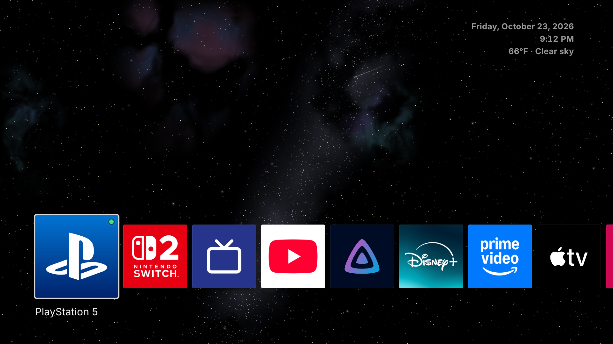
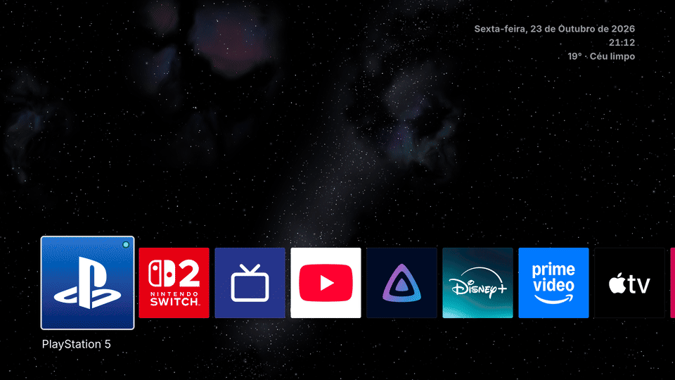

# Genkan 玄関

An ad-free home screen for LG webOS TVs: no ads, no recommendation rows, no
carousel of things you'll never watch. Just a night sky turning on true OLED
black, calm music, the time and weather, and your inputs and apps in one row.

It runs as a sideloaded web app and takes over the **Home button** and **boot**,
so the TV comes up straight into it. Everything lives inside the app package: it
edits no OS files, and a plain uninstall gives the TV back its own home.



<p align="center">
  
</p>

---

## Features

- **A night sky** — stars, a Milky Way band with dust lanes, faint nebulae, a
  few distant galaxies and tonight's moon, drawn with WebGL at the panel's 4K
  and turning slowly, with twinkling stars and a shooting star every few
  seconds. The turn also keeps any one OLED pixel from staying lit for long.
- **Calm music** — [Holst's *Venus, the Bringer of Peace*](https://en.wikipedia.org/wiki/The_Planets#II._Venus,_the_Bringer_of_Peace)
  looping underneath. It pauses while another app is in front and fades back in
  when you return.
- **Clock and weather** — date, time and the current weather in the top right
  corner, from [Open-Meteo](https://open-meteo.com) (no account or key required).
- **A PS4-style row** — HDMI inputs, apps and the TV's settings. Left and Right
  slide the row under the selected tile, which stays on the left; OK opens it.
  genkan starts on the tile opened last.
- **Screensaver** — after two minutes without input the clock, the row and the
  music fade away and only the sky keeps turning; the next key brings them back
  and does nothing else. The TV's own screensaver is vetoed, and after half an
  hour the panel switches off (the TV stays on) until any key lights it again.
- **Input dots** — a green dot on an input tile means the TV sees a device on at
  that HDMI port (from the HDMI signal or HDMI-CEC).
- **Night mode** — from 22:00 to 06:00: dimmer text and tiles, the music at a
  third of its volume, and the screensaver after 45 seconds.
- **Home button + boot** — HOME, BACK out of an app, and a cold boot or wake from
  standby all land in genkan.
- **TV language** — The application follows the TV's menu language, with
  translations for English, Brazilian Portuguese and Spanish (English for any
  other).

---

## Prerequisites

1. **A rooted LG webOS TV** with the
   [Homebrew Channel](https://github.com/webosbrew/webos-homebrew-channel) and
   its SSH server on, reachable as `root` with your `~/.ssh/id_ed25519` key. The
   boot hook needs the Homebrew Channel; LG's Developer Mode alone can't keep
   genkan as the home.
2. **Node.js** — the version in [`mise.toml`](mise.toml).
3. **The webOS CLI:** `npm i -g @webos-tools/cli` (provides `ares-package`).

## Setup

```sh
git clone https://github.com/joaobrandt/genkan.git
cd genkan
npm install
```

Then a `.env` with the TV's address and, for the weather, your location (read
at build time; without it the weather line stays hidden). `GENKAN_LANG` is
optional: it pins genkan to `en`, `pt-BR` or `es` whatever the TV's menus are
in. So is `GENKAN_TEMPERATURE_UNIT`, `celsius` or `fahrenheit`: without it,
the unit follows the language's country (Fahrenheit for US English).

```sh
TV_IP=192.168.x.x
GENKAN_LATITUDE=-23.55
GENKAN_LONGITUDE=-46.63
GENKAN_LANG=pt-BR
GENKAN_TEMPERATURE_UNIT=celsius
```

### Make it yours

| What | Where |
|------|-------|
| Tiles: inputs and apps, in order | [`src/tiles.ts`](src/tiles.ts) |
| Tile icons | [`public/icons/`](public/icons/) |
| Weather location | `GENKAN_LATITUDE` / `GENKAN_LONGITUDE` in `.env` |
| Another sky | `SEED` in [`scripts/make-sky.mjs`](scripts/make-sky.mjs) |
| Night hours | [`src/night.ts`](src/night.ts) |
| Screensaver and panel-off times | [`src/screensaver.ts`](src/screensaver.ts) |
| Language | `GENKAN_LANG` in `.env` |
| Temperature unit | `GENKAN_TEMPERATURE_UNIT` in `.env` |
| Wording, and another language | [`src/i18n.ts`](src/i18n.ts) |

> App IDs must match apps **installed on your TV**; an HDMI input is
> `com.webos.app.hdmi1` to `hdmi4`. List them with
> `luna-send -n 1 luna://com.webos.applicationManager/listApps '{}'` over SSH.

---

## Develop

```sh
npm run dev   # http://localhost:5173 — the layout scales to fit any window
```

Off the TV, launching a tile only logs it, and the first input shows a dot so
you can see one. `dev` and `build` make the sky into `public/sky/` first
(`npm run sky` on its own).

## Deploy to the TV

```sh
npm run deploy   # build → package → install over SSH → make it the home → launch
```

[`scripts/deploy.mjs`](scripts/deploy.mjs) packages the web app (`dist/`) and
the service together with `ares-package --no-minify` (ares' legacy minifier
chokes on Vite's output). It installs over plain SSH rather than with
`ares-install`, which fails against the rooted TV's dropbear: it streams the
`.ipk` to the TV and calls the app installer there. Then it links the boot hook
and runs it, which restarts the service on the new code and launches genkan.

---

## How genkan becomes the home

The TV brings up LG's home in two ways, and genkan takes its place in both,
without touching any OS files:

- **HOME**: surface-manager asks the app manager for the *default app of the
  "home" category* (`/usr/lib/qml/KeyFilters/systemUi.js`). LG's home is that
  default only because it's the one app declaring `"appCategory": ["home"]`.
  genkan declares it too (`public/appinfo.json`) and is made the default with
  `applicationManager/setDefaultApp`, kept in `/var/luna/preferences/general`.
  HOME then opens genkan directly.
- **BACK out of an app**, or any app closing with nothing behind it: the front
  goes empty, and a second later the app manager's last-app handler launches
  the TV's *idle app*, LG's home, as the read-only system profile says.
  Launching genkan within that second cancels the handler
  (`newapp_on_foreground`), so LG's home never starts.

Both are done by **a launcher service** in the app package
([`service/service.js`](service/service.js)). It sets the default home app at
every start (at boot the system profile's default wins until then), watches
the app in front for an empty front and launches genkan into it, launches
genkan at boot (retrying until the app manager is ready) and on waking from
standby, and, as a last fallback, replaces LG's home should anything still
launch it by name (the on-screen context menu's Home button does), with a brief
flash. The calls a dev service may not make go through `luna-send` as root.

**A boot hook** starts the service: `npm run deploy` links
[`service/autostart.sh`](service/autostart.sh) into the Homebrew Channel's
`/var/lib/webosbrew/init.d/` as `50-genkan`, which runs at every cold boot.

## Troubleshooting

- **A cold boot shows the last input first** — that's LG's boot daemon; genkan
  takes over once the Homebrew Channel starts its services, about 30 seconds
  in. With Quick Start+ on, the power button doesn't cold-boot: the TV resumes,
  and the service brings genkan back as it wakes.
- **`ares-install` fails with "Unable to exec"** — the rooted TV's dropbear kills
  its exec channel. Use `npm run deploy`, which installs over plain SSH.
- **A tile doesn't open** — its app ID isn't installed on your TV; the reason
  shows under the tile's name for a few seconds.
- **An input's dot stays off** — the TV only looks for a picture on the input
  on screen; a device on at another port shows over HDMI-CEC, so turn on
  SIMPLINK (HDMI-CEC) in the TV's settings.
- **The service's log** is on the TV at `/tmp/genkan-svc.log`.

## Uninstall

Give LG's home the default back **before** uninstalling genkan (otherwise HOME
opens nothing), and delete the boot hook, over SSH:

```sh
luna-send -n 1 luna://com.webos.applicationManager/setDefaultApp '{"category":"home","appId":"com.webos.app.home"}'
rm /var/lib/webosbrew/init.d/50-genkan
```

Then uninstall genkan like any other app.

## Credits

- Music: Holst's [*Venus, the Bringer of Peace*](https://commons.wikimedia.org/wiki/File:Holst-_venus.ogg),
  by the U.S. Air Force Heritage of America Band (public domain, as a work of
  the US government), from Wikimedia Commons.
- Weather from [Open-Meteo](https://open-meteo.com).
- [Inter](https://rsms.me/inter/) by Rasmus Andersson (SIL Open Font License).
- Icons: [Lucide](https://lucide.dev)'s gear and TV (ISC), the Homebrew
  Channel's own (MIT), the Jellyfin logo (CC BY-SA 4.0) and the public-domain
  Apple TV logo.
- Built on the [webOS Homebrew](https://www.webosbrew.org/) project's tooling.

## License

[MIT](LICENSE). The app icons under `public/icons/` belong to their respective
owners and are included only so the tiles look like the apps they open; replace
them with your own if you prefer.
